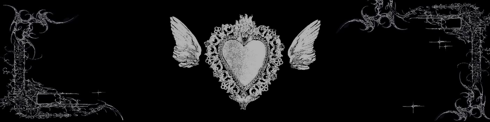

<i>Zero is worth nothing if it is without a one.</i>

Full-stack web developer, mostly Laravel and Vue. Curious about everything next to it, from machine learning and algorithms to gamedev and design.

## Projects

- [dcote.net](https://dcote.net) - Laravel, Inertia and Vue site for the DCOTE community [Code](https://github.com/DCOTE-off/dcote-site)
- [FiDEPI](https://github.com/backspace-08/FiDEPI) - Bene–Anthony Family Relations Test as a Vue browser game [Demo](https://backspace-08.github.io/FiDEPI/)
- [COTE Megaverse](https://github.com/backspace-08/cotemegaverse) - Telegram gacha bot with a 3×3 card arena and a CFR-driven PvE opponent
- [cotemegasolver](https://github.com/backspace-08/cotemegasolver) - CFR solver in Rust (PyO3) for the COTE Megaverse 3×3 arena

---

<a href="https://t.me/backspace_08">telegram</a>

